# swTASK

<p align="center">
  
</p>

Structured concurrency for Luau.  
Replaces `coroutine` / `task.spawn` / DIY parallel with a colon-first API.  
Adapts other modules (Promise, swNET, …) into the same job graph.

## Principles

1. App code never talks about coroutines, Actors, or thread pools  
2. **Safe by default**  -  Instance + network friendly  
3. **`cpu`** only for pure compute  
4. **Scopes** own children (structured cancel)  
5. **`:use` / `:from` / `:on`**  -  any module can join  

Full write-up: [docs/principles.md](docs/principles.md)

## Instead of…

```luau
-- old
task.spawn(function() ... end)
task.wait(0.1)
for _, item in items do task.spawn(function() work(item) end) end

-- swTASK
SwTask:go(function() ... end)
SwTask:wait(0.1)
SwTask:each(items):map(work):await()
```

## Quick use

```luau
local SwTask = require(path.to.swTASK)
local SwNet = require(path.to.swNET)
local Promise = require(path.to.Promise)

SwTask:use("swNET", SwNet)
SwTask:use("Promise", Promise)
SwTask:configure({ maxWorkers = 64, cpuWorkers = 4 })

local job = SwTask:run(function()
	return compute()
end)
print(job:await())

-- Promise / thenable → Job
local data = SwTask:from(Promise.resolve(1)):await()

-- join Jobs + thenables
local all = SwTask:joinAll({
	SwTask:run(loadA),
	Promise.resolve("b"),
}):await()

local scores = SwTask:each(players):limit(8):map(score):await()

packets.ping.listen(SwTask.swnet:on(function(data, player)
	handle(data, player)
end))
-- or any callback API:
Remote.OnServerEvent:Connect(SwTask:on(function(player, ...)
	handle(player, ...)
end))
```

## Docs

- [Usage](docs/usage.md)
- [Tutorial](docs/tutorial.md)
- [API](docs/api.md)
- [Principles](docs/principles.md)
- [Index](docs/index.md)

## Tests

```
python sim_test/test_swtask.py
```

## License

MIT
